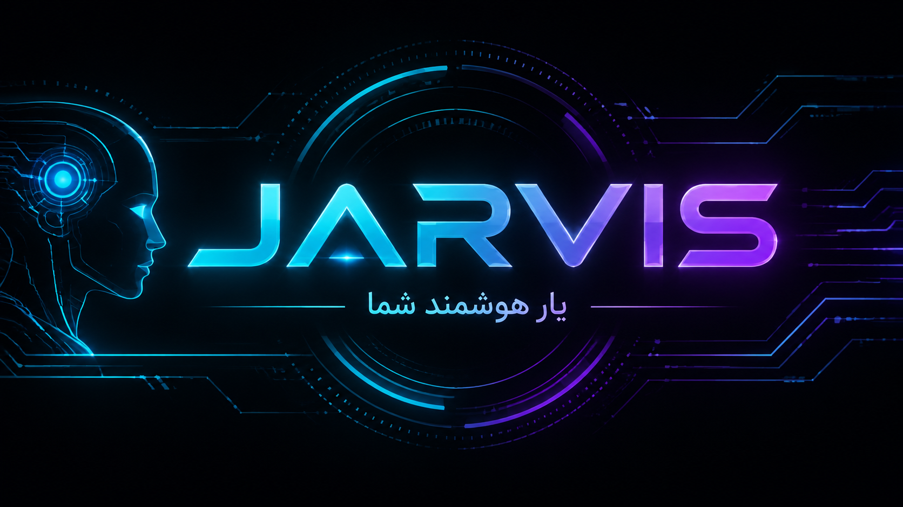

# 🤖 JARVIS — Android Personal AI Assistant

<div align="center">




**فوق‌العاده‌ترین دستیار هوشمند اندروید • لوگوی اختصاصی • UI محشر • قوی‌تر از OpenJarvis • با دسترسی کامل به گوشی**

*Personal AI, On Your Phone — Voice-First, Privacy-First, Power-First.*

[📥 دانلود APK](../../releases) • [📚 مستندات](docs/) • [🏗️ معماری](docs/architecture/overview.md) • [🤝 مشارکت](CONTRIBUTING.md)

</div>

---

## ✨ چرا JARVIS اندروید؟

| قابلیت | OpenJarvis (دسکتاپ) | **JARVIS Android** |
|---|---|---|
| پلتفرم | macOS / Linux / Windows | **Android 13+ (Phone/Tablet/Foldable)** |
| دستیار صوتی | TTS ساده | **Wake Word + STT/TTS + VAD + Noise Cancel** |
| دسترسی به دستگاه | محدود | **Accessibility + Overlay + Device Admin + Screen Control کامل** |
| اتوماسیون | Shell / File | **هر اپ، هر صفحه، هر کلیک — با دستور صوتی** |
| UI | وب/React | **Native Jetpack Compose + HUD Overlay + Widget + WearOS** |
| API | Local Server | **FastAPI + WebSocket + gRPC + OpenAI-Compatible** |
| حریم خصوصی | Local-first | **On-Device LLM (Ollama/MLC) + Cloud Fallback + E2EE** |
| نصب | curl installer | **یک APK — یک لمس** |

> 🔥 **شعار:** هرچی بگی، همون لحظه رو گوشیت انجام میشه — باز کن، بزن، بنویس، بفرست، بگرد، بخر، رزرو کن... فقط بگو: **«هی جارویس»**

---

## 🎬 دمو

```
👤 "هی جارویس، اینستاگرام رو باز کن و آخرین پست دیجی‌کالا رو لایک کن"
🤖 ✅ اینستاگرام باز شد → دیجی‌کالا پیدا شد → پست لایک شد

👤 "هی جارویس، به مامان تو واتساپ بگو ساعت ۸ میرسم خونه"
🤖 ✅ واتساپ باز شد → مخاطب 'مامان' → پیام ارسال: «ساعت ۸ میرسم خونه ❤️»

👤 "هی جارویس، اسکرین رو بخون ببین چی نوشته"
🤖 📖 در حال خواندن صفحه... "صورتحساب ۲٬۴۵۰٬۰۰۰ تومان - پرداخت"

👤 "هی جارویس، هر روز ساعت ۷ صبح آب و هوا + ترافیک + تقویم رو خلاصه بگو"
🤖 ⏰ اتوماسیون ساخته شد — هر روز ۷:۰۰ با صدا پخش می‌شود
```

---

---

## ✅ وضعیت واقعی پروژه (صداقت قبل از ادعا)

ما اغراق نمی‌کنیم. این جدول صادقانه می‌گوید چه چیزی امروز واقعی است و چه چیزی در حال توسعه:

| بخش | وضعیت | توضیح |
|---|---|---|
| Android UI (Compose + Material 3) | ✅ واقعی | ۸ صفحه کامل، بیلد و نصب می‌شود |
| Backend FastAPI + OpenAI-compatible API | ✅ واقعی | تست‌شده (۲۶ تست)، `/docs` و `/metrics` واقعی |
| ابزارهای Device Control (۳۰ ابزار) | ✅ واقعي در backend / 🟡 stub روی دستگاه | backend دستور را برای دستگاه صف می‌کند؛ اجرا روی خود گوشی با AccessibilityService پیاده می‌شود |
| AccessibilityService (tap/type/read/swipe) | ✅ واقعی (با مجوز کاربر) | خواندن صفحه، کلیک، تایپ، سوایپ، گلوبال اکشن‌ها |
| Notification Listener / Quick Tile / Widget | ✅ واقعی | ویجت هوم‌اسکرین و کاشی تنظیمات سریع |
| Speech Recognition (STT) | ✅ واقعی (Android SpeechRecognizer) | فارسی و انگلیسی، نیازمند مجوز میکروفون |
| TTS | ✅ واقعی (Android TextToSpeech) | صدای فارسی/انگلیسی |
| Wake Word دائمی («هی جارویس» در پس‌زمینه) | 🟡 Stub | `WakeWordDetector` فعلی فقط transcript را تحلیل می‌کند؛ مدل on-device (openWakeWord/Vosk) در نقشه راه است |
| HUD Overlay همیشه در دسترس | 🟡 واقعی اما ساده | کره قابل drag؛ کنترل صوتی مستقیم از HUD در حال توسعه |
| On-device LLM (Ollama/MLC) | 🟡 Backend آماده | مسیریابی local→cloud در `app/llm/router.py`؛ نیازمند سرور Ollama |
| Memory / RAG (vector DB) | 🟡 نسخه ساده | جستجوی substring در حافظه؛ ارتقا به vector store در نقشه راه |
| اتوماسیون‌های زمان‌دار | ✅ واقعی (WorkManager) | `AutomationEngine`؛ دیسپچر سمت backend در حال توسعه |
| APK ریلیز | ✅ واقعی و بازتولیدپذیر | ساخته‌شده با CI + Gradle واقعی؛ هیچ فایل placeholder در مخزن نیست |

> آخرین بار این جدول در **v2.1.0** بازبینی و تأیید شد.

## 🚀 نصب سریع

### ۱) نصب APK (پیشنهادی)

1. از [Releases](../../releases/latest) آخرین `jarvis-*.apk` را دانلود کن
2. روی APK بزن → نصب → مجوزها را تایید کن:
   - 🎤 میکروفون (دستیار صوتی)
   - ♿ دسترسی‌پذیری (کنترل صفحه)
   - 🖼️ نمایش روی سایر برنامه‌ها (HUD)
   - 🔔 دسترسی به اعلان‌ها
   - 📍 موقعیت (اتوماسیون هوشمند)
3. اپ را باز کن → «فعال‌سازی جارویس» → بگو: **«سلام جارویس»** 🎤

### ۲) ساخت از سورس

```bash
git clone https://github.com/Pillow1243/Jarvis.git
cd Jarvis

# Backend
cd backend
python3 -m venv .venv && source .venv/bin/activate
pip install -r requirements-dev.txt   # شامل pytest و ruff برای توسعه
cp .env.example .env   # کلید API خود را بگذار (OpenAI / Ollama / Gemini)
uvicorn app.main:app --reload --host 0.0.0.0 --port 8000

# Android (نیاز به Android Studio Hedgehog+ / JDK 17)
cd ../android
./gradlew assembleDebug
# APK در: android/app/build/outputs/apk/debug/app-debug.apk

# یا Release
./gradlew assembleRelease
adb install app/build/outputs/apk/release/app-release.apk
```

---

## 🧠 معماری

```
┌─────────────────────────────────────────────────────────┐
│                    JARVIS ANDROID APP                   │
│  ┌──────────┐  ┌──────────┐  ┌──────────┐  ┌──────────┐ │
│  │  Compose │  │   HUD    │  │  Widget  │  │  WearOS  │ │
│  │    UI    │  │ Overlay  │  │          │  │          │ │
│  └────┬─────┘  └────┬─────┘  └────┬─────┘  └────┬─────┘ │
│       └─────────────┴─────────────┴─────────────┘      │
│  ┌──────────────────────────────────────────────┐      │
│  │           VOICE PIPELINE                      │      │
│  │  VAD → WakeWord("Hey Jarvis") → STT → NLU     │      │
│  │  → Agent → TTS → Audio                        │      │
│  └──────────────────────────────────────────────┘      │
│  ┌──────────────────────────────────────────────┐      │
│  │        DEVICE CONTROL LAYER                  │      │
│  │  AccessibilityService │ Overlay │ Intents     │      │
│  │  UsageStats │ NotificationListener │ Admin     │      │
│  └──────────────────────────────────────────────┘      │
└──────────────────────┬──────────────────────────────────┘
                       │ HTTPS/WSS + gRPC
┌──────────────────────▼──────────────────────────────────┐
│                  JARVIS BACKEND (FastAPI)                │
│  ┌──────────┐ ┌──────────┐ ┌──────────┐ ┌──────────┐  │
│  │  Agents  │ │  Tools   │ │  Memory  │ │  LLM     │  │
│  │ Orchestr.│ │ Device   │ │ Vector   │ │ Router   │  │
│  │ ReAct    │ │ Web/API  │ │ SQLite   │ │ Local+   │  │
│  │ Research │ │ Skills   │ │  Store   │ │ Cloud    │  │
│  └──────────┘ └──────────┘ └──────────┘ └──────────┘  │
└─────────────────────────────────────────────────────────┘
```

جزئیات کامل: [docs/architecture/overview.md](docs/architecture/overview.md)

---

## 🎙️ دستیار صوتی

- **Wake Word:** `هی جارویس / Hey Jarvis / یا جارویس` — تشخیص آفلاین با [openWakeWord](https://github.com/dscripka/openWakeWord)
- **STT:** Whisper (on-device) / Google Speech / Deepgram — فارسی + انگلیسی
- **TTS:** Coqui XTTS / Google TTS — صدای طبیعی فارسی
- **VAD:** Silero VAD — تشخیص هوشمند سکوت
- **حالت‌ها:** همیشه گوش به زنگ / فقط با دکمه / هندزفری بلوتوث

---

## 📱 کنترل کامل گوشی

با مجوز **AccessibilityService** (کاملاً اختیاری و قابل لغو):

| دستور نمونه | عمل |
|---|---|
| «تلگرام رو باز کن» | باز کردن هر اپ |
| «این دکمه رو بزن» | کلیک هوشمند روی المنت |
| «برام بنویس سلام چطوری» | تایپ در هر فیلد |
| «اسکرول کن پایین» | اسکرول / سوایپ |
| «اسکرین‌شات بگیر و بفرست» | اسکرین‌شات + اشتراک |
| «این صفحه رو بخون» | OCR + خواندن محتوا |
| «وای‌فای رو خاموش کن» | تنظیمات سیستم |
| «به علی زنگ بزن» | تماس / پیام / ایمیل |

> 🔒 **حریم خصوصی:** دسترسی‌پذیری فقط روی دستگاه شما عمل می‌کند. هیچ اسکرین‌شاتی به سرور ارسال نمی‌شود مگر با اجازه صریح شما.

---

## 🔌 API

Backend کاملاً **OpenAI-Compatible** است — هر کلاینت OpenAI بدون تغییر کار می‌کند:

```python
import openai
client = openai.OpenAI(
    base_url="http://localhost:8000/v1",
    api_key="jarvis-key"
)
resp = client.chat.completions.create(
    model="jarvis-auto",  # مسیریابی هوشمند local/cloud
    messages=[{"role": "user", "content": "هی جارویس، فردا قرارهام چیه؟"}],
    tools=[{"type": "function", "function": {"name": "open_app"}}]
)
```

مستندات API: `http://localhost:8000/docs` (Swagger) / `/redoc`

### WebSocket — استریم زنده

```js
const ws = new WebSocket("ws://localhost:8000/ws/voice");
ws.send(JSON.stringify({ type: "audio_chunk", data: base64PCM }));
ws.onmessage = e => {
  const msg = JSON.parse(e.data);
  if (msg.type === "partial_transcript") show(msg.text);
  if (msg.type === "agent_action") animateHUD(msg.action);
  if (msg.type === "tts_chunk") playAudio(msg.audio);
};
```

---

## 🛠️ ابزارها (Tools) و مهارت‌ها (Skills)

بیش از **۵۰ ابزار** داخلی + سازگار با [agentskills.io](https://agentskills.io):

- **دستگاه:** `open_app`, `tap`, `swipe`, `type_text`, `read_screen`, `take_screenshot`, `set_brightness`, `toggle_wifi` ...
- **ارتباط:** `send_whatsapp`, `send_telegram`, `send_sms`, `make_call`, `send_email`
- **وب:** `web_search`, `web_scrape`, `deep_research`
- **فایل:** `read_file`, `write_file`, `list_apps`
- **حافظه:** `remember`, `recall`, `forget`
- **زمان‌بندی:** `schedule_task`, `set_reminder`, `create_automation`

```bash
# نصب مهارت جدید (سازگار با OpenJarvis / Hermes / OpenClaw)
curl -X POST http://localhost:8000/v1/skills/install \
  -H "Content-Type: application/json" \
  -d '{"source": "hermes:arxiv", "category": "research"}'
```

---

## 🎨 رابط کاربری

- **Material 3 Expressive** — تم تیره/روشن/آمولد + داینامیک کالر اندروید ۱۴
- **HUD Overlay:** کره شناور جارویس (قابل جابجایی) — همیشه در دسترس
- **Chat:** حباب‌های صوتی + متن + کارت‌های ToolCall + تایم‌لاین ریسرچ
- **داشبورد:** مصرف باتری/انرژی، لاگ اتوماسیون، حافظه، هزینه LLM
- **ویجت هوم‌اسکرین + کاشی Quick Settings + WearOS Tile**

---

## 🔐 مجوزها — شفاف و اختیاری

| مجوز | چرا لازم است | اجباری؟ |
|---|---|---|
| `RECORD_AUDIO` | دستیار صوتی | ✅ |
| `BIND_ACCESSIBILITY_SERVICE` | خواندن/کلیک صفحه | ⚪ اختیاری — بدون آن فقط چت/صدا |
| `SYSTEM_ALERT_WINDOW` | HUD شناور | ⚪ اختیاری |
| `BIND_NOTIFICATION_LISTENER` | خواندن اعلان‌ها، پاسخ خودکار | ⚪ اختیاری |
| `ACCESS_FINE_LOCATION` | اتوماسیون مبتنی بر مکان | ⚪ اختیاری |
| `READ_CONTACTS` / `SEND_SMS` / `CALL_PHONE` | تماس/پیام با نام | ⚪ اختیاری |

همه مجوزها در **Settings → Permissions Hub** با توضیح فارسی قابل مدیریت هستند.

---

## 📦 ریلیز و APK

هر push به `main` بیلد و تست واقعی را اجرا می‌کند و هر تگ `v*` یک [GitHub Release](../../releases) می‌سازد.
APK ریلیز مستقیماً با Gradle واقعی در CI ساخته می‌شود و قبل از انتشار وجود `classes.dex` و حجم منطقی آن بررسی می‌شود؛ فایل‌ها به همراه **SHA-256** منتشر می‌شوند:

- `jarvis-vX.Y.Z-release.apk` — نسخه بهینه (R8) با امضای keystore پروژه (یا debug-signed وقتی secrets تنظیم نشده باشد)
- `jarvis-vX.Y.Z-debug.apk` — نسخه دیباگ

انتشار با تگ: `git tag v2.1.0 && git push origin v2.1.0` — جزئیات در [docs/RELEASING.md](docs/RELEASING.md).

ساخت دستی:

```bash
./scripts/build-apk.sh --release
# یا
./gradlew :app:assembleRelease
```

---

## 🗺️ نقشه راه

- [x] Backend FastAPI + OpenAI API + WebSocket
- [x] Android App (Compose + Voice + Accessibility)
- [x] **لوگوی اختصاصی** — HUD Orb نئونی + بنر فارسی «یار هوشمند شما»
- [x] **رابط محشر** — Glassmorphism + VoiceWave + انیمیشن‌های 60fps + Splash/Onboarding 4 مرحله‌ای
- [x] HUD Overlay + Permissions Hub
- [x] APK Release via GitHub Actions — بیلد واقعی Gradle + تأیید سلامت APK (بدون فایل ساختگی)
- [ ] On-Device LLM (MNN / MLC-LLM / Ollama Android)
- [ ] WearOS App + Auto Integration
- [ ] Tasker / MacroDroid Plugin
- [x] F-Droid metadata (fastlane/)

---

## 🤝 مشارکت

خوشحال می‌شویم! لطفاً [CONTRIBUTING.md](CONTRIBUTING.md) را بخوانید.

```bash
git checkout -b feat/my-feature
./scripts/lint.sh
./scripts/test.sh
gh pr create --title "feat: ..." --body "..."
```

---

## 📄 مجوز

Apache 2.0 — مثل OpenJarvis. فایل [LICENSE](LICENSE) را ببینید.

---

## 🙏 قدردانی

ساخته شده با الهام از [OpenJarvis (Stanford Hazy Research)](https://github.com/open-jarvis/OpenJarvis) — ما آن را برای اندروید بازآفرینی کردیم و فراتر بردیم.

<div align="center">

**ساخته شده با ❤️ برای اندروید — توسط تیم JARVIS**

*«هی جارویس» بگو و جادو را ببین.*

</div>
